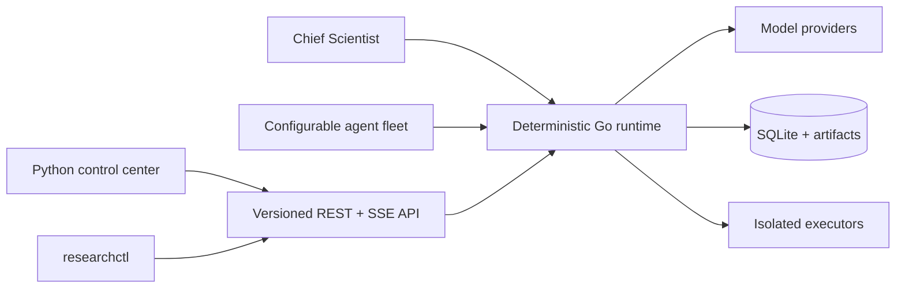

# AutoResearch

AutoResearch is an open-source runtime for long-running, multi-agent scientific research. A configurable Chief Scientist coordinates replaceable research, development, brainstorming, and criticism agents while deterministic Go infrastructure enforces budgets, scheduling, isolation, verification, and auditability.

**Current status:** All six roadmap milestones are implemented and verified, including a combined literature + experiment research session, local Hugging Face inference, and research playback. The [progress log](docs/progress.md) is the source of truth; planned features are not presented as available.

## Design principles

- **Deterministic control, nondeterministic reasoning.** Models propose actions; the runtime authorizes them.
- **Evidence over claims.** Verification requires machine-checkable evidence, not model confidence.
- **Durable research state.** Events, tasks, messages, artifacts, and the research graph survive restarts.
- **Autonomy inside explicit boundaries.** Routine work needs no approval; policy changes and external effects do.
- **Reproducibility by default.** Experiments retain revisions, configurations, logs, checksums, and negative results.

## Docker Compose

The default Compose deployment builds and starts llama.cpp, `researchd`, and the control center with loopback-only host ports. It does not mount the host Docker socket. Local single-operator authentication is mandatory even on loopback; it does not require an external identity provider or model-provider credentials.

### Generate the operator token and Compose environment file

Build `researchctl`, then perform this one-time setup as the host user who will operate the stack:

```bash
go build -o bin/researchctl ./cmd/researchctl
auth_dir="${XDG_CONFIG_HOME:-$HOME/.config}/autoresearch"
install -d -m 0700 "$auth_dir"
umask 077
./bin/researchctl auth generate --file "$auth_dir/operator.token"
chmod 0400 "$auth_dir/operator.token"
```

`auth generate` uses the operating system random source to create a 256-bit token, writes a canonical base64url value with mode `0600`, and refuses to overwrite an existing file. The final `chmod` makes the example read-only; either `0400` or `0600` is accepted. Keep the parent directory at `0700`. The file must be a regular, non-symlink file owned by the effective UID of each manual `researchd`, UI, or CLI process that loads it; assign ownership to the service UID if it differs from the generating user.

Create the required Compose environment file with the absolute token-file path, not the token value:

```bash
printf 'AUTORESEARCH_OPERATOR_TOKEN_FILE=%s\n' "$auth_dir/operator.token" > deploy/autoresearch.env
chmod 0600 deploy/autoresearch.env
```

Compose specifically requires `AUTORESEARCH_OPERATOR_TOKEN_FILE`; setting only `AUTORESEARCH_OPERATOR_TOKEN` does not satisfy its file-backed secret declaration. Optional settings can be copied from `deploy/autoresearch.env.example`. Keep both the environment file and token file out of version control.

### Start, use the CLI/API, and sign in

```bash
docker compose --env-file deploy/autoresearch.env -f deploy/docker-compose.yml up --build -d
docker compose --env-file deploy/autoresearch.env -f deploy/docker-compose.yml \
  exec -T researchd ./bin/researchctl run --config configs/local-hf.yaml --api http://localhost:8080
```

The short-lived `operator-auth-init` service copies the host secret into a private volume as UID `65532` with mode `0400`. Apart from that bootstrap's temporary read-write mount, only `researchd` and `ui` mount the volume, both read-only; other services receive neither the token value nor its path. The Compose UI also keeps NiceGUI server-side session storage in its private, UID-matched `0700` tmpfs at `/tmp/nicegui`.

For a host-side CLI, configure exactly one credential source and use the same token file:

```bash
unset AUTORESEARCH_OPERATOR_TOKEN
export AUTORESEARCH_OPERATOR_TOKEN_FILE="$auth_dir/operator.token"
./bin/researchctl status --api http://127.0.0.1:8080
```

The exact Go health check needs no credential. Other API routes, including `/metrics`, SSE, and unknown routes, require the bearer credential. This example supplies it to `curl` through standard input rather than placing it in the URL:

```bash
curl --fail --silent --show-error http://127.0.0.1:8080/healthz
printf 'header = "Authorization: Bearer %s"\n' \
  "$(tr -d '\n' < "$AUTORESEARCH_OPERATOR_TOKEN_FILE")" |
  curl --fail --silent --show-error --config - \
    http://127.0.0.1:8080/api/v1/run/status
```

Open `http://127.0.0.1:8081/login`, paste the single token line from the file into **Operator token**, and select **Sign in**. Do not put the token in a URL. **Log out** revokes the current UI session. Use `docker compose --env-file deploy/autoresearch.env -f deploy/docker-compose.yml down` to stop the stack.

### Native Kimi worker fleet

`provider: kimi-web` connects workers to the official Kimi Code `kimi web` server through its experimental KAP API. Each worker owns a separate provider instance, KAP session, and workspace; a shared server is only the transport, not a shared conversation. The Chief Scientist can independently use OpenAI/Astra or another configured provider.

The local operator token is still required. Kimi OAuth is separate and is needed only when deliberately using a Kimi subscription:

```bash
export AUTORESEARCH_CONFIG=configs/kimi-web-demo.yaml
docker compose --env-file deploy/autoresearch.env -f deploy/docker-compose.yml -f deploy/kimi-web.compose.yml --profile kimi-web up -d --build
# Complete OAuth interactively when you are ready to use your own Kimi subscription:
docker compose --env-file deploy/autoresearch.env -f deploy/docker-compose.yml -f deploy/kimi-web.compose.yml --profile kimi-web exec -it kimi-web kimi login
```

Use `configs/kimi-web-fleet.example.yaml` as the OpenAI-Chief/native-Kimi-worker template and configure its actual model, prices, and quotas before a live run. The default native mode is `manual` for Kimi built-in tools; runtime-authorized tools remain autonomous. `make native-kimi-test` verifies real session isolation and the private token relay without OAuth, model prompts, or paid generation. See [provider integration](docs/provider-integration.md) and [deployment](docs/deployment.md) for limitations.

## Single-operator authentication

`researchd`, the NiceGUI UI, and every `researchctl` command that calls the API require exactly one of:

- `AUTORESEARCH_OPERATOR_TOKEN`: the token value; or
- `AUTORESEARCH_OPERATOR_TOKEN_FILE`: an owner-only token file, recommended for normal use.

Setting both or neither is a startup/command error. Use `researchctl auth generate --file` rather than inventing a password. Offline `researchctl init`, `researchctl validate`, and `researchctl auth generate` remain credential-free. Demo wrappers generate an ephemeral owner-only token file when no file is configured and remove it during cleanup; an explicitly configured valid token file is reused and preserved.

The Go API compares fixed-length token digests in constant time and accepts one Bearer authorization header. Only exact `GET /healthz` bypasses API authentication: `/healthz/`, query variants, other methods, every `/api/v1` route, `/metrics`, and unknown routes all require the bearer. The CLI attaches the bearer to REST, polling, and SSE and refuses to forward it through redirects. The UI health check is public only for `GET /health`; its login endpoints, favicon, and required static/framework assets are also reachable so an operator can sign in. Operational pages, runtime proxies, callbacks, and WebSockets require a valid UI session.

UI token verification also uses constant-time digest comparison. Successful login creates an expiring server-side NiceGUI session, not a cookie containing the operator token. Cookies are HttpOnly, SameSite Strict, and finite (`AUTORESEARCH_UI_SESSION_MAX_AGE`, default `28800` seconds, maximum 24 hours); HTTPS deployments also use Secure cookies. A random signing secret independent of the operator token is generated at each UI startup. Exact Host/Origin allowlists and per-client login throttling protect the UI. Logout or expiry clears authentication, disconnects existing clients, cancels SSE streams, and prevents further callbacks. `NICEGUI_STORAGE_PATH` must be a private UID-matched directory and is forced to mode `0700`.

Loopback HTTP remains the default. Non-loopback deployment requires HTTPS termination, exact host/origin allowlists, and restrictive network controls; do not expose the plain-HTTP daemon directly. For a manual remote UI, set entries such as `AUTORESEARCH_UI_ALLOWED_HOSTS=research.example.test` and `AUTORESEARCH_UI_ALLOWED_ORIGINS=https://research.example.test`, including explicit ports where applicable. Wildcards and non-loopback HTTP origins are rejected. The shipped Compose allowlists are loopback-only, so a remote deployment needs an explicit Compose override as well as HTTPS.

There is currently one fully privileged operator identity: OIDC, multiple users, and RBAC are not implemented.

### Rotation

Generate a replacement at a new path, atomically replace the source file, rerun the Compose bootstrap, and restart both token consumers:

```bash
./bin/researchctl auth generate --file "$auth_dir/operator.token.next"
chmod 0400 "$auth_dir/operator.token.next"
mv "$auth_dir/operator.token.next" "$auth_dir/operator.token"
docker compose --env-file deploy/autoresearch.env -f deploy/docker-compose.yml \
  run --rm --no-deps operator-auth-init
docker compose --env-file deploy/autoresearch.env -f deploy/docker-compose.yml \
  restart researchd ui
```

For manual deployments, replace the file in the same way and restart both `researchd` and the UI under their service manager. Restarting `researchd` invalidates the old API bearer; restarting the UI creates a new startup signing secret and invalidates existing UI sessions. Operators must sign in again, and CLI/API clients must read the replacement token.

## Architecture



The backend is Go. The control center is Python. SQLite WAL, filesystem artifacts, and a single-node deployment keep the initial system understandable and operable on an ordinary VPS.

## Quick start

Requires Go 1.24, Python 3.12+, and [`uv`](https://docs.astral.sh/uv/) for the demo process wrapper and control center. Deterministic demos need no external model-provider credentials or GPU. Local operator authentication is still mandatory: the wrappers automatically generate ephemeral credentials unless an operator token file is explicitly configured.

```bash
make validate
make test
make test-integration
make auth-test
make run-demo
make literature-demo
make experiment-demo
make full-research-demo
make local-model-demo
make browser-test
```

The demo builds `researchd` and `researchctl`, starts a loopback API, and completes an autonomous Chief Scientist run with two research workers and independent criticism.

### Manual daemon, CLI, API, and UI

For a new manual installation, generate a token as the same unprivileged user that will run all three processes. Skip the one-time generation command when reusing the Compose credential created above; it deliberately will not overwrite an existing file.

```bash
go build -o bin/researchd ./cmd/researchd
go build -o bin/researchctl ./cmd/researchctl
auth_dir="${XDG_CONFIG_HOME:-$HOME/.config}/autoresearch"
install -d -m 0700 "$auth_dir"
umask 077
./bin/researchctl auth generate --file "$auth_dir/operator.token"
chmod 0400 "$auth_dir/operator.token"
unset AUTORESEARCH_OPERATOR_TOKEN
export AUTORESEARCH_OPERATOR_TOKEN_FILE="$auth_dir/operator.token"
./bin/researchd --config configs/autoresearch.yaml
```

In another terminal, configure the same credential before running API CLI commands:

```bash
unset AUTORESEARCH_OPERATOR_TOKEN
export AUTORESEARCH_OPERATOR_TOKEN_FILE="${XDG_CONFIG_HOME:-$HOME/.config}/autoresearch/operator.token"
./bin/researchctl run --config configs/autoresearch.yaml
./bin/researchctl status
./bin/researchctl agents
./bin/researchctl tasks
./bin/researchctl budget
./bin/researchctl logs --follow
./bin/researchctl report
./bin/researchctl chat --message "Summarize current status"
./bin/researchctl pause
./bin/researchctl resume
```

For direct API use, send `Authorization: Bearer <token>` as shown in the Compose example. To start the UI in a third terminal:

```bash
unset AUTORESEARCH_OPERATOR_TOKEN
export AUTORESEARCH_OPERATOR_TOKEN_FILE="${XDG_CONFIG_HOME:-$HOME/.config}/autoresearch/operator.token"
export NICEGUI_STORAGE_PATH="${XDG_STATE_HOME:-$HOME/.local/state}/autoresearch/nicegui"
install -d -m 0700 "$NICEGUI_STORAGE_PATH"
cd web
uv run --frozen --no-dev python -m autoresearch_ui.main
```

The manual UI defaults to `http://127.0.0.1:8081`, API `http://127.0.0.1:8080/api/v1`, and exact loopback Host/Origin allowlists. Sign in at `http://127.0.0.1:8081/login` with the same token. If using a dedicated service account, make its numeric UID the owner of the token and storage paths instead of widening their permissions.

Research state uses SQLite WAL, transactional events/snapshots, durable messages, budget snapshots, and checksummed artifacts. Forced-termination recovery is tested against the real daemon. The scientific layer includes a revisioned research graph, verifier-gated hypotheses, FTS5 paper/claim search, a deduplicating arXiv/PDF fetcher, and a cited literature-review demo. Experimental execution includes pinned Docker isolation, Git worktrees, benchmark/custom-command verification, reproducibility records, and an SSH adapter. The NiceGUI control center provides live dashboards, fleet details, an interactive research graph, budget charts, experiments, events, reports, persistent Chief Scientist chat, and operator controls. Research playback, shared provider rate limiting, bounded context compaction, Prometheus metrics, W3C trace context, and a bounded local Qwen narration provider are also included. Optional production hardening is documented in `docs/progress.md`. See [deployment](docs/deployment.md), [configuration](docs/configuration.md), and the [roadmap](docs/roadmap.md).

## Documentation

Start with the [vision](docs/vision.md), [architecture](docs/architecture.md), and [security model](docs/security.md). Important decisions are recorded in [ADRs](docs/adr/). Development coordination lives in [docs/progress.md](docs/progress.md). Multi-agent delegation patterns and boundaries are documented in [Multi-agent development](docs/multi-agent-development.md). Authentication coverage and acceptance targets are listed in [Testing](docs/testing.md).

## Contributing and security

Contributions are welcome; see [CONTRIBUTING.md](CONTRIBUTING.md). Never submit credentials, private datasets, private research, or real infrastructure addresses. Report security concerns according to [SECURITY.md](SECURITY.md).

## License

AutoResearch is available under the [MIT License](LICENSE).
