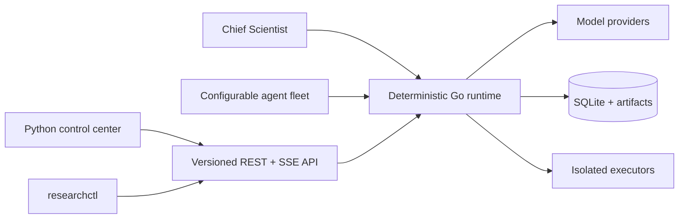

# AutoResearch

AutoResearch is an open-source runtime for long-running, multi-agent scientific research. A configurable Chief Scientist coordinates replaceable research, development, brainstorming, and criticism agents while deterministic Go infrastructure enforces budgets, scheduling, isolation, verification, and auditability.

**Current status:** Milestones 1–5 (autonomous runtime, persistence, scientific research, verified execution, and the Python control center) are implemented and verified. Milestone 6 is active. The [progress log](docs/progress.md) is the source of truth; planned features are not presented as available.

## Design principles

- **Deterministic control, nondeterministic reasoning.** Models propose actions; the runtime authorizes them.
- **Evidence over claims.** Verification requires machine-checkable evidence, not model confidence.
- **Durable research state.** Events, tasks, messages, artifacts, and the research graph survive restarts.
- **Autonomy inside explicit boundaries.** Routine work needs no approval; policy changes and external effects do.
- **Reproducibility by default.** Experiments retain revisions, configurations, logs, checksums, and negative results.

## Architecture



The backend is Go. The control center is Python. SQLite WAL, filesystem artifacts, and a single-node deployment keep the initial system understandable and operable on an ordinary VPS.

## Quick start

Requires Go 1.24 and Python 3.12+ for the demo process wrapper and control center. No API credentials or GPU are needed.

```bash
make validate
make test
make test-integration
make run-demo
make literature-demo
make experiment-demo
```

The demo builds `researchd` and `researchctl`, starts a loopback API, and completes an autonomous Chief Scientist run with two research workers and independent criticism. To operate a daemon manually:

```bash
go build -o bin/researchd ./cmd/researchd
go build -o bin/researchctl ./cmd/researchctl
./bin/researchd --config configs/autoresearch.yaml
# In another terminal:
./bin/researchctl run --config configs/autoresearch.yaml
./bin/researchctl status
./bin/researchctl agents
./bin/researchctl tasks
./bin/researchctl budget
./bin/researchctl logs --follow
./bin/researchctl report
./bin/researchctl chat --message "Summarize current status"
./bin/researchctl pause
./bin/researchctl resume
```

Research state uses SQLite WAL, transactional events/snapshots, durable messages, budget snapshots, and checksummed artifacts. Forced-termination recovery is tested against the real daemon. The scientific layer includes a revisioned research graph, verifier-gated hypotheses, FTS5 paper/claim search, a deduplicating arXiv/PDF fetcher, and a cited literature-review demo. Experimental execution includes pinned Docker isolation, Git worktrees, benchmark/custom-command verification, reproducibility records, and an SSH adapter. The NiceGUI control center provides live dashboards, fleet details, an interactive research graph, budget charts, experiments, events, reports, persistent Chief Scientist chat, and operator controls. Research playback and additional long-horizon hardening belong to Milestone 6. See [deployment](docs/deployment.md), [configuration](docs/configuration.md), and the [roadmap](docs/roadmap.md).

## Documentation

Start with the [vision](docs/vision.md), [architecture](docs/architecture.md), and [security model](docs/security.md). Important decisions are recorded in [ADRs](docs/adr/). Development coordination lives in [docs/progress.md](docs/progress.md).

## Contributing and security

Contributions are welcome; see [CONTRIBUTING.md](CONTRIBUTING.md). Never submit credentials, private datasets, private research, or real infrastructure addresses. Report security concerns according to [SECURITY.md](SECURITY.md).

## License

AutoResearch is available under the [MIT License](LICENSE).
