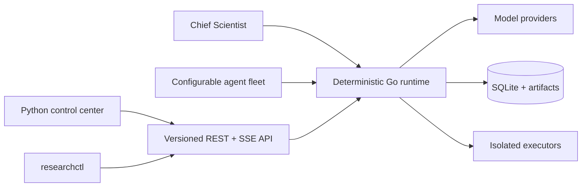

# AutoResearch

AutoResearch is an open-source runtime for long-running, multi-agent scientific research. A configurable Chief Scientist coordinates replaceable research, development, brainstorming, and criticism agents while deterministic Go infrastructure enforces budgets, scheduling, isolation, verification, and auditability.

The project is under active development. The [progress log](docs/progress.md) is the source of truth for implemented functionality; planned features are not presented as available.

## Design principles

- **Deterministic control, nondeterministic reasoning.** Models propose actions; the runtime authorizes them.
- **Evidence over claims.** Verification requires machine-checkable evidence, not model confidence.
- **Durable research state.** Events, tasks, messages, artifacts, and the research graph survive restarts.
- **Autonomy inside explicit boundaries.** Routine work needs no approval; policy changes and external effects do.
- **Reproducibility by default.** Experiments retain revisions, configurations, logs, checksums, and negative results.

## Architecture

The backend is Go. The control center is Python. SQLite WAL, filesystem artifacts, and a single-node deployment keep the initial system understandable and operable on an ordinary VPS.

## Quick start

A credential-free deterministic demonstration is planned as the first end-to-end acceptance test. See [deployment](docs/deployment.md), [configuration](docs/configuration.md), and the [roadmap](docs/roadmap.md) for current status and exact verification commands.

## Documentation

Start with the [vision](docs/vision.md), [architecture](docs/architecture.md), and [security model](docs/security.md). Important decisions are recorded in [ADRs](docs/adr/). Development coordination lives in [docs/progress.md](docs/progress.md).

## Contributing and security

Contributions are welcome; see [CONTRIBUTING.md](CONTRIBUTING.md). Never submit credentials, private datasets, private research, or real infrastructure addresses. Report security concerns according to [SECURITY.md](SECURITY.md).

## License

AutoResearch is available under the [MIT License](LICENSE).
