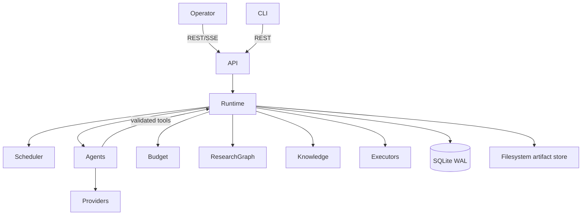
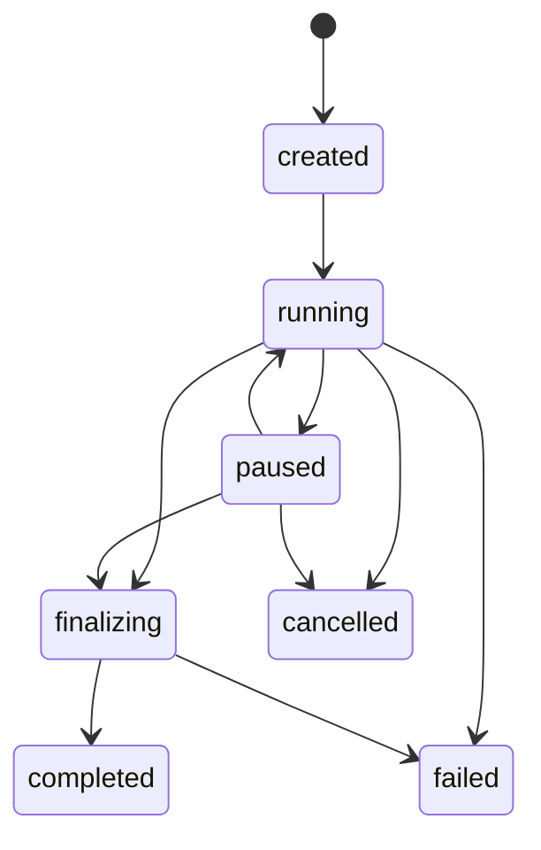

# Architecture

## System context

The Go daemon owns all writes to runtime state. The CLI and Python web application use the same versioned API and never modify the database directly. Providers return proposals; only the runtime changes tasks, budgets, experiments, or verification state.

## Component boundaries

| Component | Owns | Does not own |
| --- | --- | --- |
| Configuration | Strict decoding, reference resolution, snapshots | Live policy mutation |
| Provider | Model transport, capabilities, usage, streaming | Agent policy, budgets |
| Agent backend | Native or external agent session | Durable research state |
| Scheduler | Readiness, priority, leases, retries, backpressure | Scientific priorities |
| Messaging | Durable addressed messages and idempotency keys | Model conversation |
| Budget | Reservations, reconciliation, limits | Provider pricing discovery |
| Research graph | Claims, hypotheses, evidence and revisions | Free-form chat |
| Knowledge | Papers, normalized metadata, FTS and citations | Unattributed model assertions |
| Executor | Isolated jobs, logs, cancellation, resources | Verification decisions |
| Verifier | Objective criteria and signed result records | Experiment implementation |
| Event store | Ordered append-only audit records | All current-state queries |
| API | Versioned contracts, controls and event streaming | Direct storage mutation |

## State model

SQLite holds transactional current-state snapshots for schedulable and queryable entities, plus an append-only event log in the same transactions. Events provide audit, replay, metrics, and UI updates; snapshots avoid rebuilding every scheduler query from history. Large logs, PDFs, code, and reports are content-addressed files referenced by checksum.

A research run has one immutable configuration snapshot. Each agent receives only the credentials required for its provider, never a shared host credential bundle.

## Lifecycles

Agent states are `created`, `initializing`, `idle`, `running`, `waiting`, `retrying`, `finalizing`, `completed`, `failed`, and `cancelled`. Heartbeats, provider activity, executor activity, and meaningful output are separate timestamps. A live agent can still be scientifically stuck.

Tasks begin pending, become leased while dependencies and capacity permit, then complete, fail, retry, or cancel. Lease expiry makes abandoned work eligible for recovery. Execution is at least once: idempotency keys suppress duplicate state transitions, but external side effects must be idempotent or explicitly reconciled.

## Request and event flow

1. The supervisor receives an objective and proposes tool calls.
2. The runtime validates schemas, permissions, budget, and current state.
3. A transaction updates snapshots, durable mailboxes, and the event sequence.
4. The scheduler leases ready work to compatible idle agents.
5. Workers submit findings and artifacts; critics review evidence.
6. Verifiers, not model assertions, set objective verification status.
7. Finalization reserves resources, writes a report, and seals the run.

## Deployment

The initial target is one Linux host, one daemon, one SQLite database, loopback API, optional reverse proxy, and isolated local or remote executors. There is deliberately no PostgreSQL, Redis, Kafka, Kubernetes, or vector database.

## Known trade-offs

A single writer simplifies recovery but limits scale. SQLite FTS is less semantic than embeddings but transparent and reproducible. At-least-once execution requires careful idempotency. Monetary limits are conservative controls, not a mathematically exact provider-side cap when price or usage is unknown.
