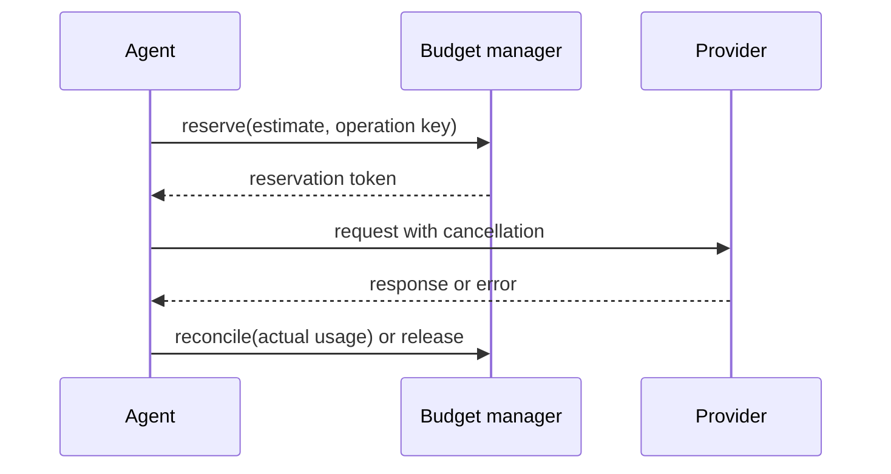

# Budget Management

Budget enforcement is deterministic Go policy. Prompts cannot increase it.

## Reservation lifecycle

Before a model request, the manager atomically reserves its configured maximum estimated cost and token/request quantities under a mutex or transaction. Concurrent requests cannot reserve the same capacity. Completion reconciles estimated and confirmed usage. Cancellation or unknown usage is handled conservatively according to provider policy; reservations expire only through explicit recovery rules.

Recovery transfers each persisted open reservation from reserved to uncertain usage without double-counting it, including provider-specific ledgers. Missing provider accounts are reconstructed from their open estimates before transfer. Persistence failures roll back in-memory reservation/settlement transitions so callers can retry or release the original reservation without stranded capacity. Successful settlements remain single-use.

## Dimensions

Accounting independently tracks money, input/output/reasoning/cached tokens, requests, provider quotas, runtime, CPU, GPU, disk, and parallelism. Agent instances for the same provider endpoint share one rate limiter, so per-provider limits are not multiplied by fleet size. Pricing is configurable and versioned in the run snapshot. Estimated and provider-confirmed cost remain separate. Unknown metrics are `null`, never zero or invented values.

## Limits

At the soft limit, new directions and expensive experiments stop, the supervisor is notified, existing work follows policy, and finalization begins with its dedicated reserve. At the hard limit, further requests are rejected, cancellable work is stopped, state is persisted, and the run finalizes or stops according to policy.

## Limitations

A local monetary hard cap cannot be mathematically exact when a provider does not guarantee pre-request cost, reports usage late, or bills interrupted requests. Reservations provide conservative local admission control. Provider-side quotas remain an additional required safeguard for real unattended spending.

## Tests

Tests exercise concurrent reservations, exact-boundary admission, exhaustion, over-reporting, cancellation, unknown usage, duplicate reconciliation, restart recovery, finalization reserve isolation, and independent quota dimensions. No paid calls are used.
