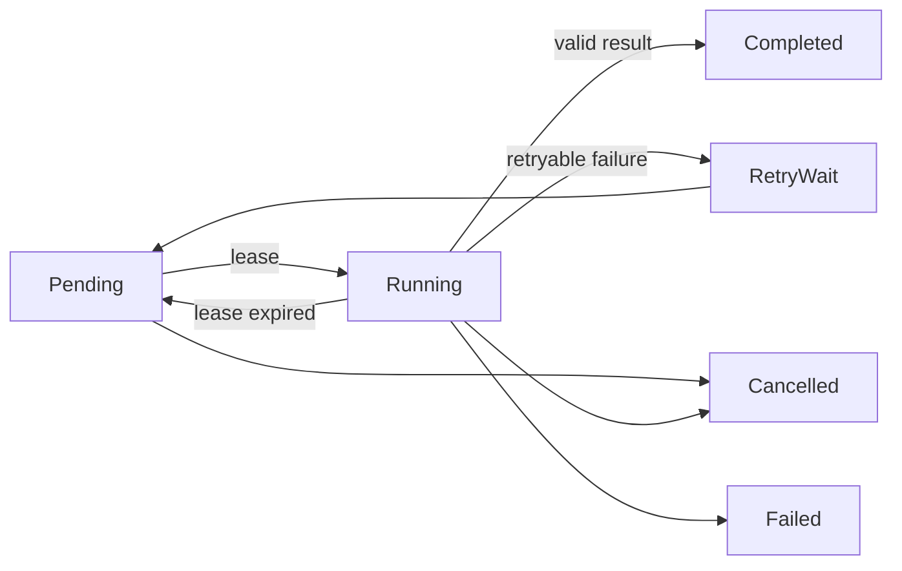

# Scheduler and Lifecycle

## Scheduling

The scheduler selects the highest-priority ready task whose dependencies are satisfied, agent capabilities match, leases are available, and resource limits permit execution. Dynamic task creation uses the same transaction and validation as initial tasks.

## Rules

- Dependencies form a directed acyclic graph; cycles are rejected.
- A unique active idempotency key prevents duplicate tasks created by retries.
- Leases have an owner, expiry, and fencing token. Expired owners cannot commit results.
- Retry counts, backoff, deadlines, cancellation, and last errors are durable.
- Worker headcount, provider limits, executor slots, and global task limits provide backpressure.
- Dependency failure policy is explicit: block, propagate cancellation, or allow independent branches.
- Priority changes do not preempt unless policy explicitly requests cancellation.

## Recovery

On startup, running leases with dead owners expire or are reclaimed according to their fencing token. Completed results remain completed. In-flight model calls and jobs are assumed possibly executed; recovery reconciles provider request IDs, executor job IDs, and idempotency keys before retrying.

## Stuck detection

A stuck task has no meaningful progress within its configured interval even if its process heartbeat is fresh. Responses include retry, cancellation, supervisor notification, or lease extension with evidence. The scheduler never silently drops overdue work.

## Execution semantics

The runtime guarantees at-least-once dispatch, not exactly-once external execution. Callers supply stable operation keys. Tests cover crash points before dispatch, after dispatch before result persistence, after result persistence before acknowledgment, lease expiry, and duplicate completion.
